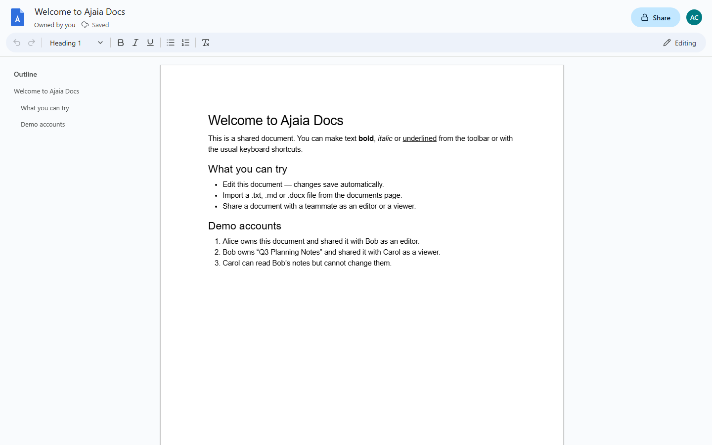

# Ajaia Docs

A lightweight collaborative document editor inspired by Google Docs. You can create and format documents, import `.txt` / `.md` / `.docx` files, and share documents with teammates as an **editor** or a **viewer**. Documents are stored in Postgres and the app runs as a single Cloudflare Worker.

**Live app:** https://ajaia-docs.salesdesk-app.workers.dev



## Try it in 5 minutes

Sign-in is a demo account picker with no passwords. Three users are seeded:

| User | Email | Seeded data |
|---|---|---|
| Alice Chen | `alice@ajaia.test` | Owns **Welcome to Ajaia Docs** and has shared it with Bob as an editor |
| Bob Patel | `bob@ajaia.test` | Editor on Alice's doc; owns **Q3 Planning Notes**, shared with Carol as a viewer |
| Carol Ruiz | `carol@ajaia.test` | Viewer on Bob's notes (read-only) |

1. Sign in as **Alice** and open *Welcome to Ajaia Docs*. Try headings, bold, italic, underline and the two list types. The status next to the title shows *Saving…* and then *Saved*. Refresh the page and the formatting is still there.
2. Go back to the documents page and choose **Import a file** (`.txt`, `.md` or `.docx`, up to 2 MB). The file opens as a new document.
3. In any document you own, click **Share**, enter `carol@ajaia.test`, choose *Viewer* and click Share.
4. Open the avatar menu, choose **Switch account** and sign in as **Carol**. The document is listed under *Shared with me* with a *Viewer* badge, and it opens read-only.
5. Sign in as **Bob** and open *Welcome to Ajaia Docs*. Bob is an editor, so he can change it. Bob cannot delete it or change who has access.

## What works

- **Documents:** create, rename (inline title), edit, delete (owner only). The list is split into *My documents* and *Shared with me*, shows the owner and your role for each document, and has a search box.
- **Editing:** TipTap editor with bold, italic, underline, Normal text or Heading 1–3, bulleted and numbered lists, undo/redo and clear formatting. The usual keyboard shortcuts work. A document outline on the left lists the headings.
- **Autosave:** saves 1 s after you stop typing. Only one save is in flight at a time, the status is always visible, and a failed save shows *Couldn't save — Retry*. Leaving the page saves any pending change first.
- **Conflict safety:** every save carries the document version. If someone else (or another tab) saved first, the server returns 409 and you are asked to reload. Your save never silently overwrites theirs.
- **Sharing:** the owner adds people by email as *Editor* or *Viewer*, can change their role, or remove them. Every rule is enforced by the server:

  | | owner | editor | viewer | no access |
  |---|---|---|---|---|
  | view | ✅ | ✅ | ✅ | 404 |
  | edit / rename | ✅ | ✅ | 403 | 404 |
  | delete, manage sharing | ✅ | 403 | 403 | 404 |

- **Import:** `.txt`, `.md` and `.docx` files up to **2 MB** become new documents. In `.docx` files, headings, bold, italic and lists are kept; **images and tables are dropped**. Scripts and event handlers are stripped from the content.
- **Losing access while a document is open:** if the owner removes you or deletes the document, your next save shows "You no longer have access to this document" and the editor locks.

## Run locally

Requirements: Node 20+ (developed on Node 24) and a Postgres database. Any Postgres works; the deployment uses a free Aiven instance.

```bash
npm install
cp .env.example .env              # set DATABASE_URL and CLOUDFLARE_HYPERDRIVE_LOCAL_CONNECTION_STRING_HYPERDRIVE (same DB)
cp .dev.vars.example .dev.vars    # set SESSION_SECRET to any long random string
npm run db:migrate                # create the tables
npm run db:seed                   # Alice, Bob, Carol + 2 demo documents (safe to re-run)
npm run dev                       # http://localhost:5173 (SPA + Worker API via the Cloudflare Vite plugin)
```

| Command | What it does |
|---|---|
| `npm test` | Vitest: permission matrix, API access/validation via `app.request()`, repository semantics, autosave queue, file import (83 tests) |
| `npm run test:e2e` | Playwright browser tests against `BASE_URL` (default `http://localhost:5173`); they create and delete their own documents |
| `npm run typecheck` | TypeScript checks for the SPA, the Worker and the tooling |
| `npm run deploy` | Build and `wrangler deploy` |

For example, to run the end-to-end tests against production:

```bash
BASE_URL=https://ajaia-docs.salesdesk-app.workers.dev npm run test:e2e
```

> Windows note: run Vitest from PowerShell or cmd. In Git Bash the lowercase `d:` working directory makes Vitest load itself twice.

### Deploy your own copy

```bash
npx wrangler login
npx wrangler hyperdrive create ajaia-db --connection-string="$DATABASE_URL"   # put the id in wrangler.jsonc
npx wrangler hyperdrive update <id> --caching-disabled true                    # documents must never be served stale
npx wrangler secret put SESSION_SECRET
npm run db:migrate && npm run db:seed && npm run deploy
```

## Project layout

```
shared/types.ts        API types shared by the Worker and the SPA
worker/                Hono API: routes/, lib/ (permissions, session, validation, access), db/ (Drizzle schema, PgRepo, MemoryRepo)
src/                   React SPA: pages/, components/, editor/ (TipTap extensions, save queue), import/ (file conversion)
drizzle/               SQL migrations
scripts/seed.ts        demo data
e2e/                   Playwright tests
specs/                 brief, product spec, implementation plan, engineering practices, AI decision log
docs/                  ARCHITECTURE.md, AI_WORKFLOW.md, screenshots
```

## Known limitations

- No real-time co-editing. Two people editing the same document at once get a conflict prompt, not merged edits.
- Sign-in is a demo account picker with no passwords or real accounts.
- No comments, version history, images, tables or export.
- After a conflict you can only reload; there is no way to keep or merge your unsaved local edits.
- The Aiven free-tier database may be powered off after long inactivity. If the app shows connection errors, the database needs to be started again.

See [docs/ARCHITECTURE.md](docs/ARCHITECTURE.md) for design decisions and what I would build next, and [docs/AI_WORKFLOW.md](docs/AI_WORKFLOW.md) for how AI was used.
